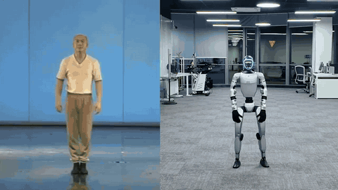

# SuperMimic-Repro-Sim2Real

[中文](README.md) | English

This repository teaches a Unitree G1 humanoid robot to copy human motion. First we train it in simulation to follow a reference motion. Then we export the trained policy and run it on the real robot. With it, a G1 danced a full ~46 s routine from start to finish.

The method comes from the [SuperMimic paper](https://arxiv.org/abs/2610.28480) (Liao et al., CoRL 2026). It first trains a neural network to stand in for the physics simulator and predict how the robot will move (the paper calls it a "world model"). Because this network is differentiable, the controller can then be trained with ordinary backpropagation through it, instead of trial-and-error reinforcement learning.

<p align="center"><a href="https://github.com/NJU-R-L-Group-Embodied-Lab/SuperMimic-Repro-Sim2Real/releases/download/v1.0/shanshenbu_real_robot_v3.mp4"></a><br><sub>Left: human source video. Right: real G1. Click for the full video with sound (~46 s).</sub></p>

The real-robot demo video and pretrained models are on [GitHub Releases](https://github.com/NJU-R-L-Group-Embodied-Lab/SuperMimic-Repro-Sim2Real/releases).

> **Safety warning**: the real-robot code drives the G1's motors directly. A wrong model, wrong settings or an operator mistake can make the robot fall, break, or hurt someone. Only run it with the robot on a hoist, and always have one person holding the remote, ready to press L2+B to put the robot into damping mode (a soft emergency stop). Read [docs/DEPLOY_G1.md](docs/DEPLOY_G1.md) in full before you start. This project is provided as is. Use it at your own risk.

## Who this builds on

- The code was not written from scratch. The training algorithm builds on Yuxi Liu's open-source reproduction [CuboiLeo/SuperMimic-Reproduced](https://github.com/CuboiLeo/SuperMimic-Reproduced) (MIT License).
- On top of it we added: training on a large dataset, custom dance motions, a tool that extracts motion from video, and the full code for running on the real robot.
- This is an unofficial reproduction. It is not affiliated with the paper authors or with Unitree. Where the paper leaves details out, we made our own choices, so our numbers may not match the paper.

## Results

A score of 1.0 means the robot follows the reference motion perfectly. Higher is better.

| Training data | Our score | Paper's score |
|---|---|---|
| LAFAN1 (40 clips), exactly the paper's setup | 0.56 | 0.82 |
| LAFAN1, plus the robot's position relative to the reference (`--env.anchor-obs`) | 0.90 | – |
| BONES-SEED (~130k clips), exactly the paper's setup | 0.93; 46 of ~130k clips failed | above 0.90; 25 failed |

- With the paper's exact setup our LAFAN1 score is well below the paper's. Adding that position input closes the gap, but the real robot can't measure its own position in the room, so such a model can't be deployed.
- Real robot: a G1 ran the full ~46 s sequence of 4 dances back to back. Its body tilt was never more than 16.3° off the reference (the safety stop is at 20°).
- For detailed numbers and the reasons behind them, see [docs/METHOD.md](docs/METHOD.md#results).

## Quick start

### Install

Training needs Linux and an NVIDIA GPU (driver ≥ 580); the robot side only needs numpy, onnxruntime and the Unitree SDK. Dependencies are managed with [uv](https://docs.astral.sh/uv/).

```bash
git clone https://github.com/NJU-R-L-Group-Embodied-Lab/SuperMimic-Repro-Sim2Real.git && cd SuperMimic-Repro-Sim2Real
uv sync --group dev
uv run pytest tests -q          # some tests need a GPU or converted data
```

### Data

The datasets are not shipped with this repository. Download them yourself and follow their licenses. The smallest example is LAFAN1. Download it, then convert it to the training format:

```bash
uv run hf download lvhaidong/LAFAN1_Retargeting_Dataset --repo-type dataset --local-dir data/raw/lafan1
uv run python scripts/data/csv_to_npz_batch.py --input-dir data/raw/lafan1/g1 --output-dir data/npz/lafan1 --input-fps 30 --workers 16
```

For the large BONES-SEED dataset (download, filtering, packing), see [docs/METHOD.md](docs/METHOD.md#data-and-filtering).

### Training in simulation

```bash
uv run sm-train --run-name lafan1_paper --data.npz-dir data/npz/lafan1 \
  --env.num-envs 4096 --policy-trainer.batch-size 4096 --schedule.max-hours 3
```

- The defaults follow the paper. Run `uv run sm-train --help` to see every option.
- Checkpoints are saved every so often to `logs/<run>/ckpt_XXXXXXX.pt`. Watch training curves in TensorBoard.
- For BONES-SEED or several GPUs, see [docs/METHOD.md](docs/METHOD.md#data-and-filtering).

### Evaluation and visualization

```bash
# Play every clip from start to end; report the score and the number of failures
uv run python scripts/eval_benchmark.py --ckpt logs/lafan1_paper/ckpt_XXXXXXX.pt --npz-dir data/npz/lafan1
# Replay in a window (with no display, it uses the browser instead: http://localhost:8080)
uv run python scripts/play.py --ckpt logs/lafan1_paper/ckpt_XXXXXXX.pt --clips dance1_subject1
# Render an mp4 without a window (solid = policy, see-through blue = reference)
MUJOCO_GL=egl uv run --with imageio --with imageio-ffmpeg python scripts/render_video.py \
  --ckpt <ckpt> --clips dance1_subject1 --seconds 30 --tag demo
```

## Real-robot deployment

There are three steps:

1. Export the trained model to an ONNX file.
2. Test it again and again in simulation on Unitree's official robot model, with added disturbances such as delay, extra weight and changed friction. It only counts as ready if it passes every test (see [docs/SIM2SIM.md](docs/SIM2SIM.md)).
3. Run the control program on the robot's own computer. Start with the robot hanging in the air, then lower it to the ground step by step.

```bash
# sim2sim gates (Release model)
python scripts/deploy/sim2sim.py --cmd g2,g3,report --clips combo_c4_full_vc_b15f20 --tag combo --ckpt e13i_0291000 --workers 16
# first real-robot stage: hanging
python scripts/deploy/bridge/g1_runner_bridge.py --iface <nic> --domain 0 --stage air \
  --artifacts deploy_artifacts/<ckpt> \
  --clip deploy_artifacts/clips/<clip>.npz \
  --log-dir deploy_logs/real
```

These run in the deploy environment; setup is in [docs/SIM2SIM.md](docs/SIM2SIM.md) and [docs/DEPLOY_G1.md](docs/DEPLOY_G1.md). The program stops itself on large tilt, fast joints or hot motors, but you still need the hoist and the remote (see the safety warning above).

## Documentation

| File | What it covers |
|---|---|
| [docs/METHOD.md](docs/METHOD.md) | How the algorithm is implemented, where it differs from the paper, and why |
| [docs/CUSTOM_MOTIONS.md](docs/CUSTOM_MOTIONS.md) | How to train on your own dance motions and run them on the robot |
| [docs/VIDEO_TO_MOTION.md](docs/VIDEO_TO_MOTION.md) | How to turn a dance video into motion the robot can perform |
| [docs/SIM2SIM.md](docs/SIM2SIM.md) | How to export a model, and which simulation tests it must pass before the real robot |
| [docs/DEPLOY_G1.md](docs/DEPLOY_G1.md) | Real-robot manual: safety, remote buttons, step-by-step procedure, troubleshooting |
| [docs/REFERENCES.md](docs/REFERENCES.md) | BibTeX for everything we cite |

## Pretrained models

Download them from [GitHub Releases](https://github.com/NJU-R-L-Group-Embodied-Lab/SuperMimic-Repro-Sim2Real/releases). Each model comes with its training checkpoint and ready-to-deploy ONNX files.

- `e11c_0220000`: the base model, trained on BONES-SEED.
- `e13i_0291000`: the base model trained further on BONES-SEED plus 4 custom dances (not on the 4 dances alone). The Release also has a video of it dancing on the real robot.

To use one: extract it into `deploy_artifacts/`, re-run the simulation tests from [docs/SIM2SIM.md](docs/SIM2SIM.md), then follow [docs/DEPLOY_G1.md](docs/DEPLOY_G1.md) to run it on the robot. The scripts default to older models that are not in the Release, so always pass `--ckpt e13i_0291000` (sim2sim) or `--artifacts deploy_artifacts/e13i_0291000` (runner). Both models were trained on BONES-SEED; check its data terms before you use them.

The Release does not include the motion goal table `deploy_artifacts/clips/<clip>.npz`; generate it with `--cmd clips` as in [docs/SIM2SIM.md](docs/SIM2SIM.md#exporting-the-deploy-bundle). The robot's onboard computer (PC2) has an older onnxruntime, so copy `policy_ir9.onnx` over `policy.onnx` there.

```bash
mkdir -p deploy_artifacts
tar -xzf /path/to/e13i_0291000.tar.gz -C deploy_artifacts/   # -> deploy_artifacts/e13i_0291000/
```

## License

This project uses the MIT License; see [LICENSE](LICENSE). It keeps the copyright notices of both the upstream author, Yuxi Liu, and this repository's author, Hongyu Ding. Notices for third-party software and datasets are in [LICENSES/](LICENSES/).

## Citation

If this repository helps you, please cite the original paper first, and please also cite the upstream reproduction code:

```bibtex
@inproceedings{liao2026supermimic,
  title         = {SuperMimic: Scaling Humanoid Whole-Body Control with One Differentiable World Model},
  author        = {Liao, Qiayuan and Shao, Yiyang and Long, Junfeng and Zakka, Kevin and Horowitz, Roberto and Abbeel, Pieter and Sreenath, Koushil},
  booktitle     = {Conference on Robot Learning (CoRL)},
  year          = {2026},
  eprint        = {2610.28480},
  archivePrefix = {arXiv},
  primaryClass  = {cs.RO},
  url           = {https://arxiv.org/abs/2610.28480}
}

@misc{liu2026supermimicreproduced,
  title        = {SuperMimic-Reproduced: Reproduction of SuperMimic (arXiv:2610.28480) on mjlab/MuJoCo Warp},
  author       = {Liu, Yuxi},
  year         = {2026},
  howpublished = {\url{https://github.com/CuboiLeo/SuperMimic-Reproduced}},
  note         = {GitHub repository, MIT License}
}
```

## Acknowledgements

Thanks to these projects. All BibTeX entries are in [docs/REFERENCES.md](docs/REFERENCES.md).

- [mjlab](https://github.com/mujocolab/mjlab): the simulation training framework
- [BeyondMimic](https://arxiv.org/abs/2508.08241): how the motion-tracking task is set up
- [MuJoCo](https://github.com/google-deepmind/mujoco) / [MuJoCo Warp](https://github.com/google-deepmind/mujoco_warp): the physics engines
- [Unitree SDK](https://github.com/unitreerobotics/unitree_sdk2) / [Unitree MuJoCo model](https://github.com/unitreerobotics/unitree_mujoco): talking to the real robot, and the official robot model
- [GVHMR](https://github.com/zju3dv/GVHMR) / [GMR](https://github.com/YanjieZe/GMR) / [SMPL-X](https://smpl-x.is.tue.mpg.de/): extracting motion from video (GVHMR and SMPL-X are for non-commercial use only)
- [LAFAN1](https://huggingface.co/datasets/lvhaidong/LAFAN1_Retargeting_Dataset) / [BONES-SEED](https://huggingface.co/datasets/bones-studio/seed): the motion datasets

"Unitree" and "G1" are trademarks of Unitree Robotics.
